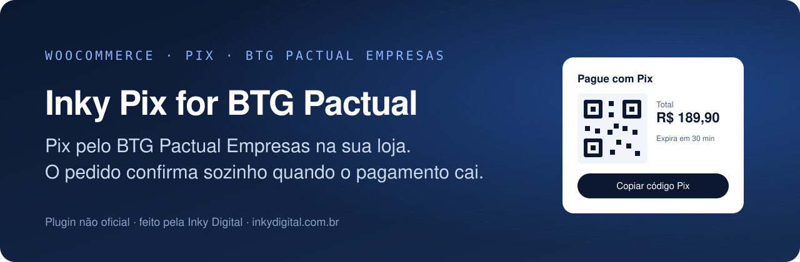
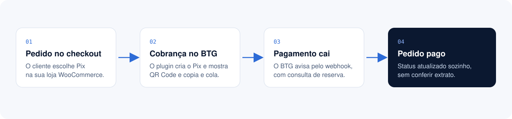

  

  
  
  
  
  

# Inky Pix for BTG Pactual: gateway Pix do BTG Pactual Empresas para WooCommerce

Receba **Pix pelo BTG Pactual Empresas** na sua loja WooCommerce. O cliente vê o QR Code e o código copia e cola no checkout, paga pelo app do banco, e o pedido muda para pago sozinho quando o pagamento cai.

Até onde pesquisamos, não havia um gateway BTG para WooCommerce publicado. Este é o nosso, aberto e gratuito.

> Plugin **não oficial**, sem vínculo com o BTG Pactual. BTG Pactual é marca do seu titular.

  

## O que ele faz

| | |
|---|---|
| **Cobrança Pix** | Cria a cobrança na API de Pix Cobrança do BTG Pactual Empresas no fechamento do pedido. |
| **QR Code e copia e cola** | No checkout clássico e no checkout por blocos do WooCommerce. |
| **Confirmação automática** | Webhook do BTG e, como reserva, consulta periódica das cobranças em aberto. Botão "Verificar pagamento agora" no pedido. |
| **Token que se renova** | Conexão pelo OAuth do BTG (Authorization Code), com renovação automática do token. |
| **Autorização sem acesso ao WordPress** | Gera um link para a pessoa da empresa autorizar a conta no BTG sem entrar no painel da loja. |
| **Credenciais cifradas** | Client ID, Client Secret e tokens cifrados no banco, com os salts da instalação. |
| **Sandbox e produção** | Ambientes separados, com credenciais e tokens independentes. |
| **Sem Pix em dobro** | A criação de cobrança nunca é repetida automaticamente quando a resposta do banco é incerta. |

## Requisitos

- WordPress 6.2+, WooCommerce ativo e PHP 8.1+ com OpenSSL.
- Loja publicada em HTTPS, para o retorno do OAuth e o webhook.
- Conta no BTG Pactual Empresas e um aplicativo no portal de desenvolvedores do banco, com o escopo `empresas.btgpactual.com/pix-cash-in`, Client ID, Client Secret e uma chave Pix da conta recebedora.

## Instalação

1. Baixe o `.zip` da [última versão](../../releases) e envie em **Plugins > Adicionar novo > Enviar plugin**. Ative.
2. Abra **WooCommerce > PIX BTG Pactual > Conexão**. O ambiente inicial é o sandbox.
3. Copie a URL de redirecionamento mostrada pelo plugin e cadastre-a exatamente no aplicativo do BTG.
4. Informe Client ID, Client Secret e a chave Pix. Os valores são cifrados e nunca saem do seu banco de dados.
5. Clique em **Conectar** e autorize a conta no BTG. O CNPJ da empresa vem do próprio token.
6. Faça o teste de conexão e um pedido de teste no sandbox, numa loja de homologação.
7. Em produção, cadastre no BTG a URL da aba **Webhook**, com os eventos `instant-collection.paid` e `instant-collection.unlinked`, e salve no plugin o segredo desse webhook (é diferente do Client Secret).

Enquanto faltar chave Pix, credencial ou autorização, o Pix não aparece no checkout.

## Segurança

- O repositório e o pacote não contêm credenciais. Elas ficam cifradas no banco da loja. Proteja os backups e o `wp-config.php`.
- O webhook exige `Authorization: Bearer` com o segredo configurado, e o pedido só é confirmado quando o `txId` recebido bate com a cobrança do pedido e o status é `PAID`.
- O sandbox do BTG usa respostas estáticas: o plugin nunca marca como pago um pedido de sandbox.

## Status: beta

O pacote passa na checagem de sintaxe do PHP e nos testes locais de carregamento, montagem do pedido à API e cifragem. Antes de usar em produção, confirme numa cobrança de baixo valor:

- os campos de criação da cobrança e a resposta com `txId` e `emv` (ou URL do QR Code);
- a consulta individual de cobrança no seu ambiente;
- a entrega HTTPS do webhook e o segredo dele.

Encontrou um comportamento diferente na sua conta? Abra uma [issue](../../issues).

## Precisa integrar outra coisa?

O Inky Pix for BTG Pactual foi feito pela **[Inky Digital](https://inkydigital.com.br)**, que desenvolve sistemas sob medida e integra lojas, ERPs, CRMs e meios de pagamento para operações que não podem parar.

Se a sua loja, o seu ERP e o seu banco ainda não conversam, [fale com a Inky](https://inkydigital.com.br/contato).

Se o plugin ajudou, deixe uma estrela no repositório. Ajuda outras lojas a encontrarem.

## Licença

[GPL v2 ou posterior](LICENSE).
